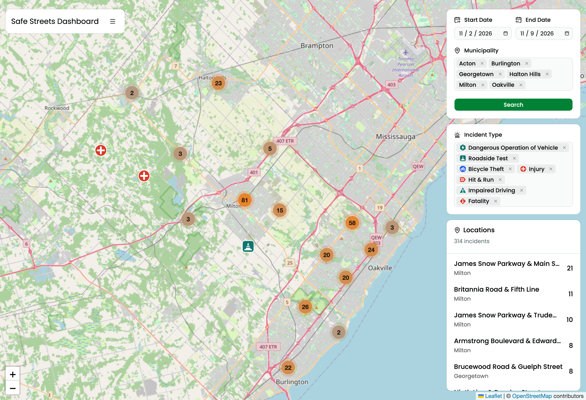

# Safe Streets Dashboard

This dashboard uses data from the Halton Regional Police Services to display stats and maps of traffic-related incidents in Halton Region.


## Why this dashboard?

The [existing dashboard](https://experience.arcgis.com/experience/e2d6a32212ba438da4144ea42dfccaf9) for the Halton Regional Police is limited to the past 365 days, data prior to that is deleted.
By keeping records locally, we are able to perform long-term time-series analysis that currently isn't facilitated. The dashboard aims to make understanding safety issues simpler, and raising awareness of the issue in Halton as well as solutions.

## How it works

1. A separate pipeline (`HRPS_Pipeline`, a private Deno/TypeScript service) pulls incident data from the Halton Regional Police [ArcGIS REST API](https://developers.arcgis.com/rest/) `Crime_Map` FeatureServer once a day via `Deno.cron` (and exposes an admin-triggered `Deno.serve` endpoint for manual/backfill runs). It validates each record with Valibot and upserts it into the database, keyed on the ArcGIS `GlobalID`.
2. This NextJS app has no separate backend server - its own `src/app/api/*` route handlers query the database directly using [Drizzle ORM](https://orm.drizzle.team/). The database is Postgres.
3. The NextJS React web application fetches from its own API routes (via SWR, coordinated by an XState state machine and Redux Toolkit) and displays the results on a map using [Plotly](https://plotly.com/javascript/react/) and [Leaflet](https://leafletjs.com/).

## Offline development (local database)

Requires Docker.

```bash
pnpm local-db:sync   # while online: copies the last 180 days into local Postgres (`pnpm local-db:sync 365` for a year)
pnpm dev-local       # offline: starts the container, migrates, runs next dev against it
pnpm local-db:down   # stop the container (data persists in a docker volume)
```

## Deploying to Cloudflare Workers

The dashboard deploys as a Cloudflare Worker using [vinext](https://github.com/cloudflare/vinext), configured in `cloudflare.config.ts` and `vite.cloudflare.config.ts`. The regular Next.js scripts (`dev`, `build`, `start`) still work as before.

```bash
pnpm run dev:vinext     # local dev server under vinext (port 3001)
pnpm run build:vinext   # production Worker build
pnpm run deploy:vinext  # build and deploy (Workers Builds does this on push to main)
```

The Worker reads Postgres through a [Hyperdrive](https://developers.cloudflare.com/hyperdrive/) binding named `HYPERDRIVE`. Hyperdrive holds the database host, credentials and CA certificate, so none of the `DB_*` variables are needed in production.

Deploys are run by [Workers Builds](https://developers.cloudflare.com/workers/ci-cd/builds/), Cloudflare's GitHub integration, on every push to `main`. In the Worker's build settings:

| Setting         | Value                                                                        |
| --------------- | ---------------------------------------------------------------------------- |
| Build command   | _(empty; the deploy command builds the app)_                                 |
| Deploy command  | `pnpm run deploy:vinext`                                                     |
| Worker name     | `safe-streets-halton-dashboard` (must match `cloudflare.config.ts`)          |
| Build variables | `HYPERDRIVE_ID` (the dashboard's Hyperdrive config ID), `CLOUDFLARE_BUILD=1` |

### Preview deployments

Branches other than `main` get their own preview Worker through [Worker Previews](https://developers.cloudflare.com/workers/previews/). In the Worker's build settings (**Settings > Build**):

| Setting               | Value                                                                     |
| --------------------- | ------------------------------------------------------------------------- |
| Enable Preview Builds | On (**Branch control**)                                                   |
| Preview command       | `pnpm run preview:deploy`                                                 |
| Build variables       | The same `HYPERDRIVE_ID` and `CLOUDFLARE_BUILD=1` apply to preview builds |

If the dashboard shows a **Set up Worker Previews** banner, complete that one-time switch first (it cannot be undone).

`vinext-cloudflare previews deploy` builds the app itself with `isPreview` set (using `vite.cloudflare.config.ts`) and then runs `cf previews deploy`, so the build command stays empty. `cloudflare.config.ts` leaves out the production custom domain for previews, so a preview never touches `streetsdash.nickmorrison.me`. Previews use the same read-only Hyperdrive config as production, so they show live production data. Preview URLs are public unless protected with [Cloudflare Access](https://developers.cloudflare.com/workers/previews/#access-control).
