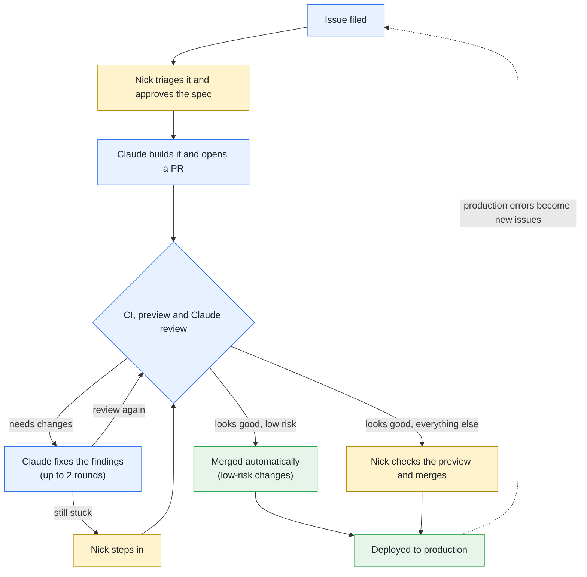

# Software factory

How an idea or bug becomes a merged PR in this repo. Nick keeps three gates: the spec, the code review he chooses to do, and the product check on the preview.

## The loop

Yellow is where Nick is needed, blue runs by itself, and green is the finish. The table below has the detail.

## The flow

| Step            | Where it runs                       | What happens                                                                                                                                                            | Who's needed       |
| --------------- | ----------------------------------- | ----------------------------------------------------------------------------------------------------------------------------------------------------------------------- | ------------------ |
| 1. File         | GitHub                              | Someone files a Feature or Bug issue from the issue forms, or the production errors task files a Bug. It gets `needs-triage`.                                           | Anyone             |
| 2. Plan         | Claude Code on Nick's Mac           | `/triage` sorts the issue. Small, clear ones get an agent brief. Bigger ones go through `/grill-with-docs`, then `/to-spec`. The spec copies in the SSHD story details. | Nick (interactive) |
| 3. Spec gate    | Claude Code on Nick's Mac           | Nick reads the final spec or brief, then says yes to the `ready-for-agent` label.                                                                                       | Nick               |
| 4. Build        | GitHub Actions (`claude-build.yml`) | Claude builds it test-first on a `fix/`, `feature/` or `chore/` branch, runs `vp check` and the unit tests, and opens a PR.                                             | Nobody             |
| 5. Verify       | GitHub Actions                      | CI, the Cloudflare preview and the Claude review (`claude-review.yml`) run on the PR.                                                                                   | Nobody             |
| 6. Product gate | Cloudflare preview                  | Nick clicks through the preview and merges.                                                                                                                             | Nick               |

If the build gets stuck, it comments on the issue and swaps the label to `needs-info` (spec unclear) or `ready-for-human` (checks won't pass). Nothing merges without Nick.

## One-time setup on the Mac

1. In Claude Code, install the skills: `claude plugin install mattpocock-skills@claude-plugins-official`
2. Make sure `gh` is signed in: `gh auth status`
3. Pull `main` in this repo. The skills config is already in `docs/agents/`, so skip `/setup-matt-pocock-skills`.

## Day to day on the Mac

From this repo in Claude Code:

- `/triage`: "show me what needs attention", or "let's look at #42".
- For a feature that needs thinking through: `/grill-with-docs` about the issue, then `/to-spec` to publish the spec.
- Before the `ready-for-agent` label goes on, check the issue type is set (Bug, Feature or Task). It picks the branch prefix.

## Review lanes

Every PR gets one `lane:` label and a short comment saying why.

| Lane        | What goes in it                                                                                                                                                      | What happens                                                                            |
| ----------- | -------------------------------------------------------------------------------------------------------------------------------------------------------------------- | --------------------------------------------------------------------------------------- |
| Auto-merge  | Only docs, tests or copy (`src/locales`), under 150 lines, from Nick or Claude's build.                                                                              | If the Claude review says "Looks good", GitHub merges it once the required checks pass. |
| Quick look  | Normal app code: UI, features, bug fixes.                                                                                                                            | Claude reviews, Nick merges.                                                            |
| Deep review | The database, server actions, API routes, config, dependencies, workflows, the factory's own instructions (`CLAUDE.md`, `AGENTS.md`, `docs/agents/`), or 600+ lines. | Nick reviews closely.                                                                   |

Plain rules (`.github/scripts/pr-lane-rules.sh`, always read from `main`) set the most relaxed lane a PR can get. Haiku then reads the diff and may make it stricter, never looser. A new push turns auto-merge off. Add the `ai-review` label to get a fresh review and lane.

### Dependabot PRs

Dependabot opens security fixes as they come out and one round of version updates each Monday (`.github/dependabot.yml`). It waits 7 days after a release before suggesting it, except for security fixes. Dependabot runs can't use the Claude token, so `dependabot-lane.yml` sorts its PRs with plain rules only (`.github/scripts/dependabot-lane-rules.sh`):

- Auto-merge: patch bumps that change only `package.json` and the lockfiles, where each dependency is either a dev dependency or a fix for a published security advisory. GitHub merges them once the required checks pass. A bump counts as a security fix when the GitHub Advisory Database lists an advisory for the old version that doesn't apply to the new one (`.github/scripts/dependabot-advisories.sh`).
- Deep review: everything else, including other app and sub-dependency bumps, minor and major bumps (even security ones), and GitHub Actions updates.

If someone pushes to a Dependabot PR, it goes through the normal lanes and the Claude review instead.

## Monitoring and the weekly retro

| What              | When                  | What it does                                                                                                                                                                                                                                           | Uses the Claude plan              |
| ----------------- | --------------------- | ------------------------------------------------------------------------------------------------------------------------------------------------------------------------------------------------------------------------------------------------------ | --------------------------------- |
| Production errors | When an error appears | Cloudflare Workers Issues sends the error to a Claude Code scheduled task, which opens a `production-error` Bug issue with `needs-triage`, or reopens the old one if the error comes back. See [production-errors-task.md](production-errors-task.md). | One short run per new error       |
| Factory retro     | Mondays, 8 AM Toronto | Collects the week's PRs, issues and runs, and Sonnet opens a `factory-retro` issue: what happened, what went wrong, up to three suggested tweaks, and docs drift.                                                                                      | One Sonnet run (skipped if quiet) |

The task takes URLs, hosts, IPs, file paths, IDs, tokens and visitor details out of the issue and defuses @mentions, because this repo is public. It only files issues and never changes code, so a fix still goes through the spec gate. To silence an error for good, mark it Ignored in Cloudflare (Workers & Pages, the Worker, Observability, Issues).

The retro only suggests. Nick decides what to change, including whether the Auto-merge lane gets wider.

## Fixing review findings

- **Claude's own PRs fix themselves, up to 2 rounds.** When the review says "Needs changes" on a PR the build opened, the `fix` job in `claude-review.yml` has Claude fix the findings, reply on each inline comment, and push. Claude's push gets a fresh review (other pushes don't). If the review still says "Needs changes" after 2 rounds, or a round pushes nothing or fails, the PR gets `ready-for-human` and waits for Nick.
- **`@claude` on any PR.** Nick can write `@claude` in a PR comment, a review, or a reply on a review comment, for example "@claude fix the review comments" (`claude-mention.yml`). Claude answers there and pushes any code changes to the PR's branch. Only Nick's comments start a run, because this repo is public.

## Limits

Everything runs on Nick's Claude Pro subscription. One build runs at a time and others queue. A build is capped at 80 turns and 60 minutes, a review at 40 turns, a fix round or an `@claude` request at 60 turns, and the weekly retro at 30 turns. Each production error costs one short task run. The Dependabot lane uses no AI.
